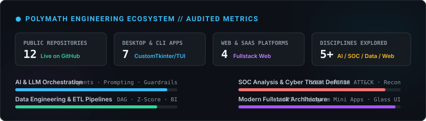

<div align="center">

# Tesla // Systems & Software Engineer 🚀

[](https://git.io/typing-svg)

<p align="center">
  
  
  
</p>

</div>

---

### 🌐 Инженерная философия

> *"Настоящий инженер не замыкается в одном фреймворке. Сила в междисциплинарном мышлении: понимать сеть на уровне сырых сокетов, видеть узкие места в базах данных, проектировать чистый UI и оркестровать агентные системы искусственного интеллекта."*

Я постоянно исследую стыки технологий: от низкоуровневого анализа протоколов и кибербезопасности до агентных пайплайнов LLM и визуального инжиниринга.

---

### 🗺️ Карта компетенций и исследовательские векторы

```
                  ┌─────────────────────────────────────┐
                  │    POLYMATH ENGINEERING DOMAINS     │
                  └──────────────────┬──────────────────┘
         ┌───────────────────┬───────┴────────┬───────────────────┐
         ▼                   ▼                ▼                   ▼
  🧠 AI & LLM Systems   🛡️ Cybersecurity   ⚙️ Data & ETL      🚀 Modern Fullstack
  ├── Prompt Engine     ├── SIEM Engine   ├── DAG Pipelines   ├── Telegram WebApps
  ├── Token Economics   ├── MITRE ATT&CK  ├── Anomaly Z-Score ├── FastAPI Services
  └── Agent Guardrails  └── TCP Recon TUI └── Streamlit BI    └── Glass/Swiss UI
```

---

### 🛠️ Технологический стек

<p align="center">
  
  
  
  
  
  
  
  
  
</p>

---

### 💼 Избранные проекты и архитектурные решения

#### 🖥️ 1. Системные комплексы, безопасность и автоматизация
| Проект | Стек | Ключевая ценность |
|---|---|---|
| [**OmniParse Studio**](https://github.com/NikolaCloud/omniparse-studio) | `Python` `CustomTkinter` `BS4` `Pandas` | Многопоточный парсинг с антидетектом, эмуляцией браузерных заголовков и ротацией прокси. 4 вкладки и экспорт в Excel/CSV. |
| [**Sentinel SIEM**](https://github.com/NikolaCloud/sentinel-siem) | `Python` `SQLite` `MITRE ATT&CK` | Центр анализа инцидентов ИБ (SOC). Корреляция логов Nginx/Linux/Windows, классификация угроз SQLi, Brute Force. |
| [**ShopFlow Telegram**](https://github.com/NikolaCloud/shopflow-telegram) | `Telebot` `FastAPI` `Telegram WebApp` | Торговая e-commerce экосистема: бот + встроенный мобильный Mini App + веб-панель управления магазином. |
| [**DataPulse ETL & BI**](https://github.com/NikolaCloud/datapulse-etl) | `Streamlit` `Plotly` `Pandas` | Автоматизированный DAG конвейер данных с детекцией аномалий по правилу трех сигм (Z-score) и BI-дашбордом. |
| [**NoteFlow Workspace**](https://github.com/NikolaCloud/noteflow-workspace) | `CustomTkinter` `Markdown` `Graph` | Десктопное пространство документации с двунаправленным графом знаний (Backlinks) и Linear Kanban. |
| [**NetRecon Terminal**](https://github.com/NikolaCloud/net-recon-terminal) | `Rich TUI` `Sockets` `DNS` | Киберпанк-консоль тактической разведки: неблокирующий сканер портов, граббер сервисных баннеров и HEX-дамп. |
| [**PromptVault Studio**](https://github.com/NikolaCloud/prompt-vault-studio) | `CustomTkinter` `Neo-Brutalism` | Платформа промпт-инжиниринга: расчет затрат инференса LLM (GPT-4o, Claude 3.5), токенизатор и шаблонизация `{{vars}}`. |

#### 🌐 2. Веб-платформы, финансовые агрегаторы и SaaS
| Проект | Стек | Визуальная стилистика |
|---|---|---|
| [**Dev Portfolio Minimal**](https://github.com/NikolaCloud/dev-portfolio-minimal) | `HTML5` `CSS3` `Vanilla JS` | **Dark Glassmorphism:** Живой интерактивный UNIX-терминал с эмуляцией команд (`help`, `cat`, `projects`). *(3 скриншота)* |
| [**Aura Estates Aggregator**](https://github.com/NikolaCloud/aura-estates-aggregator) | `Vanilla JS` `Python` `Luxury CSS` | **Warm Quiet Luxury:** Международный агрегатор недвижимости с симулятором аннуитета и Net Yield. *(3 скриншота)* |
| [**Aurora Telemetry SaaS**](https://github.com/NikolaCloud/aurora-telemetry-saas) | `Aurora Mesh CSS` `JS` `FastAPI` | **Aurora Dark Mesh:** Высоконагруженный лендинг AI-телеметрии, Flamegraph-графики и песочница метрик. *(3 скриншота)* |
| [**DevPulse Event Hub**](https://github.com/NikolaCloud/devpulse-event-hub) | `Swiss Grid` `JS` `Python` | **Swiss Typographic Grid:** Глобальный индекс инженерных саммитов, таймлайны треков и радар открытых CFP. *(3 скриншота)* |

---

### 📊 Активность и статистика GitHub

<div align="center">
  
</div>

<br>

<div align="center">
  
  
</div>

<p align="center">
  
</p>

---

### 🔬 Векторы текущего изучения (2026 — 2027)

- [x] **Автономные Multi-Agent графы:** Самостоятельные агенты с итеративной валидацией кода и памятью.
- [x] **Архитектура SIEM & Корреляция логов:** Детектирование APT-атак по матрице MITRE ATT&CK.
- [ ] **eBPF в ядре Linux:** Низкоуровневый перехват сокетов и микросекундная телеметрия без оверхеда.
- [ ] **Rust в системном программировании:** Написание высокопроизводительных сетевых парсеров без сборщика мусора.
- [ ] **Zero-Knowledge Proofs (ZKP):** Математические основы верифицируемых вычислений и криптографии.

---

### 📫 Связь и сотрудничество

<div align="center">

[](https://github.com/NikolaCloud)
[](https://t.me/)

*Открыт к сложным инженерным задачам, проектированию отказоустойчивых архитектур и интересным вызовам.*

</div>
